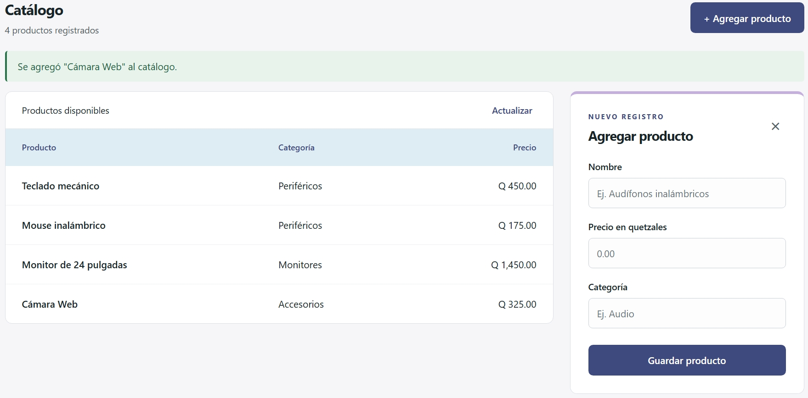

# Satoru Store

Catálogo de tecnología y accesorios con React, Express y MongoDB.
Permite consultar y agregar productos con nombre, precio y categoría.



## Funciones

- Catálogo obtenido desde una API propia y guardado en MongoDB.
- Formulario con validaciones, confirmación y mensajes de error.
- Nombres únicos: `Bocina`, `BOCINA` y ` Bocina ` se consideran el mismo nombre.
- Estados de carga, error de conexión y reintento.
- Precios en quetzales y diseño adaptable.
- Pruebas unitarias y de integración automatizadas.

## Ejecutar

Requisitos: Node.js 24, Git y MongoDB Community local en ejecución.
Compass es opcional para consultar los documentos.

```sh
git clone https://github.com/mddepazr/satoru-store.git
cd satoru-store
npm --prefix backend ci
npm --prefix frontend ci
```

Copia `backend/.env.example` como `backend/.env`. En PowerShell:

```powershell
Copy-Item backend/.env.example backend/.env
```

En Linux o macOS:

```sh
cp backend/.env.example backend/.env
```

Desde la raíz, carga los ejemplos una vez e inicia la API:

```sh
npm --prefix backend run seed
npm --prefix backend run dev
```

En otra terminal:

```sh
npm --prefix frontend run dev
```

Abre http://localhost:5173. API: http://127.0.0.1:3001/api/productos.
En PowerShell puedes usar `npm.cmd` si `npm.ps1` está bloqueado.
Para detener un servidor, pulsa Ctrl+C.

MongoDB utiliza `satoru_store`, colección `productos`.
Los datos permanecen tras reiniciar. `seed` se puede repetir sin borrar ni sobrescribir
productos existentes. `.env` contiene `MONGODB_URI`, `MONGODB_DB` y `PORT` y no se sube a Git.

## Actualizar desde la versión anterior

Detén la API anterior antes de iniciar esta rama. El inicio incorpora
`nombreNormalizado` a los documentos existentes y crea el índice único.
Conserva nombres, precios, categorías e identificadores.
Si detecta nombres duplicados, informa sus ids y se detiene antes de modificar
los documentos. Revisa esos registros en Compass, asigna nombres distintos y
vuelve a iniciar. Ningún producto se elimina automáticamente.

La comparación normaliza Unicode, mayúsculas y espacios sobrantes, conservando
acentos. La unicidad es global por nombre, aunque cambien precio o categoría.

## API

| Método | Ruta | Respuesta |
|---|---|---|
| GET | `/api/productos` | 200 y arreglo de productos |
| POST | `/api/productos` | 201 y objeto con `mensaje` y `datos` |

GET devuelve directamente `[{ id, nombre, precio, categoria }]`.
En la versión anterior devolvía `{ datos: [...] }`; el cliente React ya está adaptado.

Cuerpo del POST con `Content-Type: application/json`:

```json
{ "nombre": "Cámara web", "precio": 325, "categoria": "Accesorios" }
```

Nombre: 2–80 caracteres. Categoría: 2–40. Precio: número mayor que cero,
hasta Q1,000,000 y máximo dos decimales. Datos inválidos: 400.
Nombre repetido: 409 y mensaje para el campo nombre. MongoDB no disponible: 503.
El índice único protege también dos envíos simultáneos del mismo nombre.
`nombreNormalizado` es interno; la API no lo entrega al frontend.

## Organización y flujo

El usuario completa el formulario. React valida y envía un POST. Express recibe el
JSON; el servicio aplica las reglas y el repositorio guarda el documento en MongoDB.
La API confirma el producto y React actualiza la tabla. GET vuelve a consultar la colección.

| Ubicación | Responsabilidad |
|---|---|
| `backend/src/routes` y `controllers` | Rutas y respuestas HTTP |
| `backend/src/validators` y `domain` | Reglas de campos y normalización del nombre |
| `backend/src/services` | Coordinar validación y almacenamiento |
| `backend/src/repositories` y `config` | Acceso a MongoDB y preparación del índice |
| `backend/src/middleware` y `errors` | Errores HTTP y conflicto de duplicados |
| `backend/test/unit` y `integration` | Pruebas aisladas y del sistema integrado |
| `frontend/src/services` | Comunicación con la API |
| `frontend/src/components` y `App.jsx` | Formulario, tabla y estados de pantalla |

## Pruebas y evidencias

```sh
npm --prefix backend test
npm --prefix frontend test
npm --prefix frontend run build
npm --prefix frontend run lint
```

Las pruebas usan `node:test`. Las de integración inician un MongoDB real aislado,
sin tocar tu base local. La primera ejecución descarga el binario y necesita internet.
[Casos, resultados y capturas de semana 14](docs/pruebas-semana-14.md).

Evidencias anteriores: [catálogo](docs/01-catalogo.jpeg),
[campos vacíos](docs/02-campos-vacios.jpeg), [precio negativo](docs/03-precio-negativo.jpeg),
[conexión](docs/04-error-conexion.jpeg), [JSON anterior](docs/05-respuesta-json.jpeg),
[MongoDB](docs/06-mongodb-productos.png), [persistencia](docs/07-producto-persistente.jpeg)
y [creación](docs/08-producto-agregado.jpeg).
La captura JSON anterior conserva el formato previo; para semana 14 toma una nueva
respuesta GET con el arreglo directo.

## Autor

Marcos Daniel de Páz Rodas — Carnet 2500587  
Programación IV · Universidad San Pablo de Guatemala
